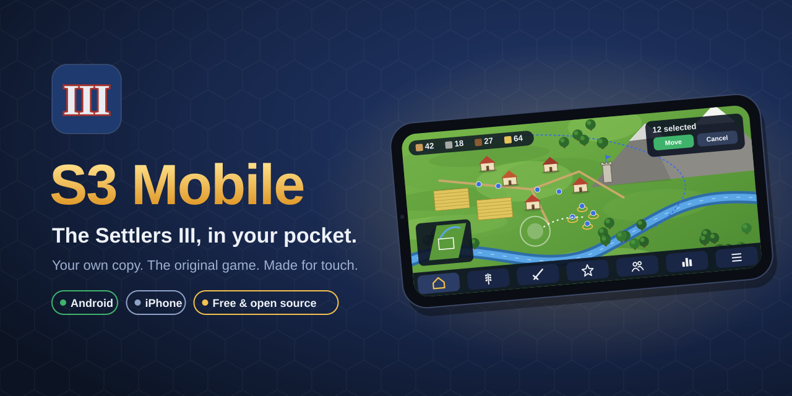
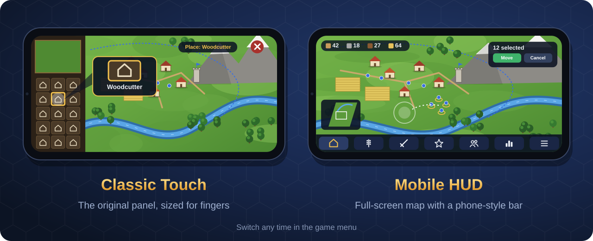
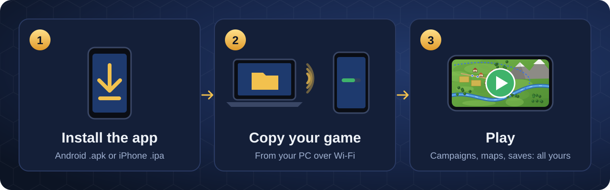
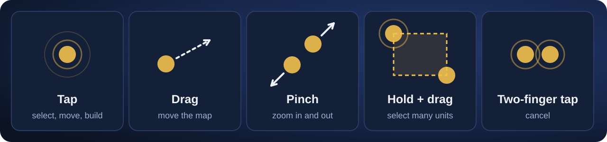

  

  
  
  

  
  
  

<h3 align="center">Build, trade and conquer, now on your phone.</h3>

  S3 Mobile runs <b>your own copy</b> of the classic <b>The Settlers III</b> on Android and iPhone. 
  It is the original game with the same campaigns, maps, music and save games, made for touch.

  <a href="https://github.com/duruer/s3-mobile/releases/latest"><b>Download</b></a> ·
  <a href="#-get-started"><b>Get started</b></a> ·
  <a href="#-how-to-play"><b>How to play</b></a> ·
  <a href="#-faq"><b>FAQ</b></a> ·
  <a href="https://github.com/duruer/s3-mobile/issues"><b>Report a problem</b></a>

---

## ✨ Why you'll love it

<table>
  <tr>
    <td width="33%" valign="top">
       
      <b>The real game, not a remake</b> 
      The original game program from your own copy. All campaigns, maps and missions play exactly as you remember them.
    </td>
    <td width="33%" valign="top">
       
      <b>Made for fingers</b> 
      Tap to select, drag to scroll, pinch to zoom. You never need a mouse or a keyboard.
    </td>
    <td width="33%" valign="top">
       
      <b>Fills your screen</b> 
      Wide phones, foldables and tablets all get a sharp picture at up to 60 frames per second.
    </td>
  </tr>
  <tr>
    <td width="33%" valign="top">
       
      <b>Easy setup</b> 
      Copy your game from your computer over Wi-Fi. Open a web page and choose the folder, then the app does the rest.
    </td>
    <td width="33%" valign="top">
       
      <b>Play together</b> 
      Multiplayer over your home Wi-Fi works between phones and PCs. It is still in testing.
    </td>
    <td width="33%" valign="top">
       
      <b>Saves, music, sound</b> 
      Everything works as in the original. On Android, your game keeps running (muted) when you switch to another app.
    </td>
  </tr>
</table>

## 🎮 Two ways to play

  

- **Classic Touch** keeps the familiar side panel and makes it finger-friendly. A magnifier shows the button under
  your finger, with its name, so you always hit the right one.
- **Mobile HUD** gives the whole screen to the map. It adds a bottom bar, big build menus, a minimap and unit cards,
  like a modern mobile strategy game. Specialists have their own buttons (for example "Find Resources" for
  geologists), and the Stats page has the tool and weapon production.

You can switch between them any time in the game menu. In Mobile HUD, the **Classic panel** button (on the unit
card and in the game menu) switches in one tap.

## 🚀 Get started

  

**What you need:** your own copy of The Settlers III. The supported version is the **GOG release ("Ultimate
Collection", version 1.60)** from [gog.com](https://www.gog.com/). You also need a computer with the game installed.
The app never downloads or contains any part of the game.

### Android (8.0 or newer, 64-bit)

1. On your phone, download the latest **`.apk`** from the
   [Releases page](https://github.com/duruer/s3-mobile/releases/latest).
2. Open the file. If Android asks whether your browser may install apps, allow it. Then tap **Install**.
3. Open **S3 Mobile**, tap **Game files**, then tap **Start upload server**. The app shows a web address and a QR
   code.
4. On your computer, open that address in a web browser. The computer must be on the same Wi-Fi as the phone.
   Choose your Settlers III folder (the one with `S3.EXE` in it) and press **Upload**. The game is about 1.7 GB,
   so this takes a few minutes. Keep the page open until it says it is done.
5. When the app says **Ready**, go back and tap **Play**. Have fun!

<b>Prefer a USB cable?</b>

Copy the whole game folder into `Android/data/com.settlers3port.app/files/game/` on the phone. Include
`regs.cmd` (GOG), because it holds your serial number. Without it, the game asks for the serial number when you
start a game.

> [!IMPORTANT]
> **Updating:** install the new `.apk` over the old one. **Do not uninstall the app first.** Uninstalling deletes
> the game files and save games stored inside it.

### iPhone and iPad (iOS 17 or newer)

The app is not in the App Store. You install it from your computer with your own Apple ID:

1. Download the latest **`.ipa`** from the [Releases page](https://github.com/duruer/s3-mobile/releases/latest)
   to your computer.
2. Install it with a sideloading tool such as [Sideloadly](https://sideloadly.io/) or
   [AltStore](https://altstore.io/). Connect the iPhone, drop the `.ipa` in and sign in with your Apple ID.
3. On the iPhone, allow the app under *Settings > General > VPN & Device Management*. If iOS asks, turn on
   *Settings > Privacy & Security > Developer Mode*.
4. Copy the game as on Android with **Game files > Start upload server**. You can also put the folder into the
   Files app under *On My iPhone > S3 Mobile > Settlers3*, or pick a folder that is already in the Files app.

> [!NOTE]
> With a free Apple ID, the app stops opening after 7 days. Install it again the same way. Your game files and
> save games stay on the phone.

## 👆 How to play

  

- **Tap** a settler or a building to select it. Tap the ground to send units there or to place a building.
- **Drag** with one finger to move the map. **Pinch** to zoom in and out.
- **Hold and drag** to draw a box and select many units at once.
- **Tap with two fingers** (or the ✕ button) to cancel.
- **Type:** tap a text field of the game, such as the game name, and the keyboard opens. When the game asks for
  your serial number, the keyboard opens by itself. Type the number with its dashes and press Enter. A tap with
  three fingers also opens or closes the keyboard.
- **Settings** on the app's start screen has the display mode, the frame rate limit and more. You can also hide
  the mouse cursor there (**Mouse cursor: off**), or in the game menu.

## ❓ FAQ

<b>Do I need to own the game?</b>

Yes. S3 Mobile contains no part of the game. You copy the game files from your own, legally bought copy to your
phone. The GOG "Ultimate Collection" is the supported version.

<b>Will my phone be fast enough?</b>

The original PC game runs inside an emulator on your phone, so a recent phone gives the smoothest play. On a
modern phone the game reaches 60 frames per second. Older phones also work, but they are slower.

<b>Does multiplayer work?</b>

Multiplayer over the local network (the same Wi-Fi) works between phones and Windows PCs. It is still in testing,
so please report any problems you find.

<b>Can I keep my PC save games?</b>

Yes. Save games are ordinary game files. Copy them along with the game folder.

<b>Something does not work. What should I do?</b>

Open an [issue](https://github.com/duruer/s3-mobile/issues) and tell us your phone model and what happened. Please
do not attach game files or parts of the game program.

## 🧭 Status

S3 Mobile is an **early release**, so expect some rough edges. These already work:

- ✅ Single player campaigns and free games
- ✅ Saving and loading
- ✅ Music and sound effects
- ✅ Two touch control styles
- ✅ Android and iPhone builds with every release
- 🧪 Multiplayer over Wi-Fi (in testing)

Every fix and new feature ships automatically as a new [release](https://github.com/duruer/s3-mobile/releases).

## ⚖️ Legal

- **S3 Mobile is not affiliated with, endorsed by or sponsored by Ubisoft, Blue Byte or GOG.**
  "The Settlers" is a trademark of Ubisoft Entertainment. All other trademarks belong to their owners. These names
  appear here only to say which game this app works with.
- **This project contains no part of the game:** no game program, graphics, sounds, music, maps or text, and no
  code taken from the game. You need your own legally obtained copy, and you copy it to your phone yourself.
- The illustrations on this page are our own drawings, not screenshots of the game. The app icon and all code in
  this repository are also our own work.
- S3 Mobile is free software under the [GNU General Public License v3.0 or later](LICENSE). It comes with no
  warranty.

## 🛠️ For developers

<b>How it works and where to start</b>

S3 Mobile is written in Rust. It loads the original Windows game program and runs it on a built-in x86 processor
emulator. It also provides its own versions of the Windows and DirectX functions that the game calls.

- [AGENTS.md](AGENTS.md): project index and rules
- [docs/porting/architecture.md](docs/porting/architecture.md): how it works, how to build and run
- [docs/porting/android.md](docs/porting/android.md) and [docs/porting/ios.md](docs/porting/ios.md): building the apps
- [docs/porting/status.md](docs/porting/status.md): what works, with measurements

The README illustrations come from `tools/readme_art.py` (run `python3 -I tools/readme_art.py`).

Contributions are welcome. The rule for code is the same as for issues: never commit game files or code derived
from the game.

---

   
  <b>Enjoying S3 Mobile? Give it a ⭐ so other fans can find it.</b>

